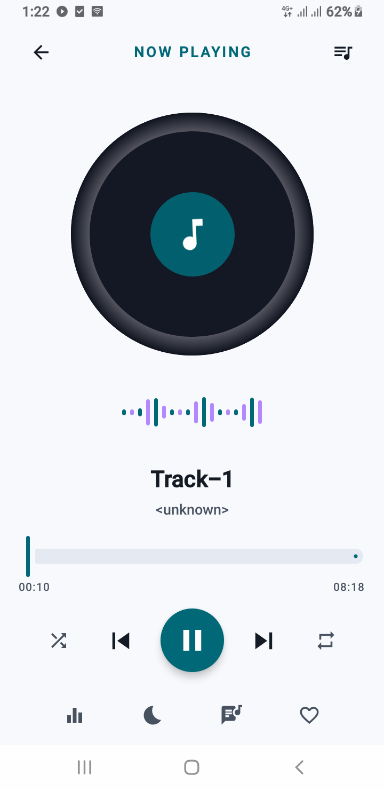

# As Player

A modern, offline-first **video and music player for Android**, built with Kotlin, Jetpack Compose and AndroidX Media3. As Player scans the media on your device and gives you a fast library, a gesture-driven video player, and a full-featured audio player with equalizer, sleep timer and background playback.

## 🎬 App Demo

<p align="center">
  <a href="https://youtube.com/shorts/RHF5FJVXlik">
    
  </a>
</p>
*Click the screenshot above to watch the app in action on YouTube.*

---

## Features

### Library
- Browse your device media in five tabs: **Videos**, **Music**, **Folders**, **Favorites** and **History**
- Search by title, artist or album
- Sort by name, date added, duration or size (ascending / descending)
- Favorites, playback history and per-item media details
- Pull in new files with a manual media refresh

### Video player
- Fullscreen player with auto-hiding controls and a screen lock
- **Gestures:** swipe vertically for brightness (left) and volume (right), swipe horizontally to seek, double-tap left/right to seek 10 seconds, double-tap center to play/pause, long-press for 2x speed
- Playback speed from 0.5x to 3.0x
- Aspect ratio modes: Fit, Fill, Zoom, 16:9 and 4:3
- Audio and subtitle track selection
- **A-B repeat** to loop a section of a video
- Picture-in-Picture and manual landscape / portrait rotation
- Resume from where you left off

### Audio player
- Now Playing screen with queue management (add, play next, remove)
- Repeat (off / all / one) and shuffle
- **Equalizer** with sound profiles, frequency sliders, bass boost and 3D surround (virtualizer)
- **Sleep timer** with preset durations and an "end of this track" option
- Lyrics view
- Media notification and lock-screen controls via a Media3 `MediaSession`

### Playlists
- Create playlists and add any video or track to them
- Play a whole playlist or start from a specific item

### Settings
- Theme: System, Light, Dark or AMOLED
- Remember playback position
- Auto-play next item
- Background playback for audio, and a separate option for video
- Enable or disable player gestures
- Clear watch history

### Supported formats
MP4, MKV, WebM, AVI, MOV, 3GP, FLAC, MP3, AAC, OGG, HLS and DASH (decoded through ExoPlayer, so exact support depends on the device's codecs).

---

## Tech stack

| Area | Technology |
|---|---|
| Language | Kotlin |
| UI | Jetpack Compose, Material 3 |
| Navigation | Navigation Compose |
| Playback | AndroidX Media3 (ExoPlayer, MediaSession, `PlayerView`) |
| Local data | Room (playlists, favorites, history, resume positions) |
| Preferences | Jetpack DataStore |
| Media discovery | Android `MediaStore` |
| Async | Kotlin Coroutines and Flow |
| Architecture | MVVM with a repository layer and a lightweight manual DI container |

---

## Project structure

```
com.example
├── AsPlayerApplication.kt        # Application class, creates the AppContainer
├── MainActivity.kt               # Entry point, theme, permissions, navigation graph
├── core
│   ├── di/AppContainer.kt        # Manual dependency container
│   ├── navigation/Screen.kt      # Navigation routes
│   └── util/FormatUtils.kt
├── data
│   ├── local                     # Room database, DAOs, entities, DataStore preferences
│   ├── mediastore                # MediaStore data source
│   ├── model                     # MediaItemModel, sample media
│   └── repository                # MediaRepository
├── feature
│   ├── library                   # Library screen, tabs, media detail sheet
│   ├── nowplaying                # Now Playing, mini player, queue, lyrics, equalizer, sleep timer
│   ├── player                    # Video player screen and track selection
│   ├── playlists                 # Playlists list and detail
│   └── settings
├── service
│   ├── player/PlayerController   # Single shared ExoPlayer and playback state
│   ├── audioeffect               # Equalizer, bass boost, virtualizer
│   ├── PlaybackService.kt        # Foreground MediaSessionService and notification
│   └── SleepTimerManager.kt
└── ui/theme                      # Colors, typography, theme
```

A single `PlayerController` owns the ExoPlayer instance and exposes its state as `StateFlow`s. Both the video screen and the audio screen observe it, so playback continues seamlessly between the library, the video player and the Now Playing screen.

---

## Getting started

### Requirements
- A recent version of Android Studio
- A matching JDK and Android SDK (see the project's Gradle files for exact versions)
- An Android device or emulator


### Permissions

On first launch the app asks for access to your media so it can build the library:

| Permission | Purpose |
|---|---|
| `READ_MEDIA_VIDEO`, `READ_MEDIA_AUDIO` (Android 13+) | Read videos and music from the device |
| `READ_EXTERNAL_STORAGE` (Android 12 and below) | Read media on older versions |
| `READ_MEDIA_VISUAL_USER_SELECTED` (Android 14+) | Support partial media access |
| `POST_NOTIFICATIONS` (Android 13+) | Show the playback notification |

You can also open a media file from a file manager with "Open with As Player".

---


## Acknowledgements

- [AndroidX Media3](https://developer.android.com/media/media3)
- [Jetpack Compose](https://developer.android.com/jetpack/compose)
- [Material Design 3](https://m3.material.io/)